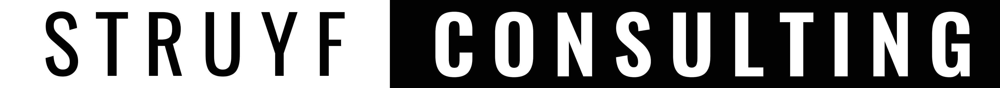

# Visual Studio Code - React UI Library (vscrui)

The `vscrui` is a React components library for building [webview-based extensions](https://code.visualstudio.com/api/extension-guides/webview) with React in Visual Studio Code.

> [!NOTE]
> The library is based on the [VS Code Webview UI Toolkit](https://github.com/microsoft/vscode-webview-ui-toolkit), which was deprecated on January 6, 2025. See the [deprecation announcement](https://github.com/microsoft/vscode-webview-ui-toolkit/issues/561) for more details. Instead of providing web components, this library provides React components.

## Installation

To install the library, run the following command:

```bash
npm install vscrui
```

> [!IMPORTANT]
> When using the `Icon` component, make sure to import the Codicon CSS file in your project. You can use the following import statement: `import 'vscrui/dist/codicon.css';`.

## Usage

To use the library, import the components you need and use them in your React components.

```tsx
import { Badge, Button, Checkbox, Label, Tag } from "vscrui";
import "vscrui/dist/codicon.css"; // If using Icons
```

### Components

<details>
<summary>Badge</summary>

```tsx
import { Badge } from "vscrui";

<Badge>99</Badge>
```
</details>

<details>
<summary>Button</summary>

```tsx
import { Button } from "vscrui";

<Button appearance="primary" onClick={() => console.log("Clicked")}>
  Primary Button
</Button>

<Button appearance="secondary">
  Secondary Button
</Button>

<Button appearance="icon" aria-label="Add">
  <span className="codicon codicon-plus"></span>
</Button>
```
</details>

<details>
<summary>Checkbox</summary>

```tsx
import { Checkbox } from "vscrui";

<Checkbox 
  checked={true} 
  onChange={(checked) => console.log(checked)}
>
  Checkbox Label
</Checkbox>
```
</details>

<details>
<summary>Divider</summary>

```tsx
import { Divider } from "vscrui";

<Divider />
```
</details>

<details>
<summary>Dropdown</summary>

```tsx
import { Dropdown } from "vscrui";

<Dropdown
  options={["Option 1", "Option 2", "Option 3"]}
  value="Option 1"
  onChange={(value) => console.log(value)}
/>

// With object options
<Dropdown
  options={[
    { label: "Option 1", value: "opt1" },
    { label: "Option 2", value: "opt2" }
  ]}
  value="opt1"
  onChange={(value) => console.log(value)}
/>
```
</details>

<details>
<summary>Icon</summary>

```tsx
import { Icon } from "vscrui";

<Icon name="add" />
<Icon name="refresh" spin />

// The size accepts a number (pixels) or any CSS length
<Icon name="add" size={24} />
<Icon name="add" size="1.5rem" />
```
</details>

<details>
<summary>Label</summary>

```tsx
import { Label } from "vscrui";

<Label>Label Text</Label>
```
</details>

<details>
<summary>Loader</summary>

```tsx
import { Loader } from "vscrui";

// Full-page overlay with a progress bar on top (default)
<Loader />

// Progress bar only, without the overlay
<Loader overlay={false} />
```
</details>

<details>
<summary>Pane</summary>

```tsx
import { Pane } from "vscrui";

<Pane 
  title="Pane Title" 
  actions={[
    { iconName: "refresh", onClick: () => console.log("Refresh") }
  ]}
>
  <p>Pane Content</p>
</Pane>

// The pane is collapsed by default. Use `open` to expand it and `onClick` to
// react to the user toggling it.
<Pane
  title="Pane Title"
  open={true}
  onClick={(isOpen) => console.log(isOpen)}
>
  <p>Pane Content</p>
</Pane>
```
</details>

<details>
<summary>PaneActionButton</summary>

The icon button `Pane` renders for each of its `actions`. Use it directly when you compose your own header.

```tsx
import { PaneActionButton } from "vscrui";

<PaneActionButton 
  iconName="refresh" 
  onClick={() => console.log("Refresh")} 
/>
```
</details>

<details>
<summary>PaneHeader</summary>

The collapsible header used by `Pane`. Use it directly when you want to control the open state yourself.

```tsx
import { PaneHeader } from "vscrui";

const [open, setOpen] = useState(false);

<PaneHeader
  open={open}
  triggerOpen={() => setOpen(!open)}
  actions={[
    { iconName: "refresh", onClick: () => console.log("Refresh") }
  ]}
>
  Pane Title
</PaneHeader>
```
</details>

<details>
<summary>Panels (Tabs)</summary>

```tsx
import { Panels } from "vscrui";

<Panels
  tabs={[
    { id: "tab1", label: "Tab 1" },
    { id: "tab2", label: "Tab 2" }
  ]}
  views={[
    { id: "tab1", content: <p>Tab 1 Content</p> },
    { id: "tab2", content: <p>Tab 2 Content</p> }
  ]}
/>

// Control which tab is selected and listen for changes
<Panels
  tabs={tabs}
  views={views}
  activeTab="tab2"
  onTabChange={(id) => console.log(id)}
/>
```

> [!NOTE]
> A tab is only rendered when its `id` matches the `id` of one of the `views`.

</details>

<details>
<summary>Tab</summary>

The tab button used by `Panels`. Use it directly when you build your own tab list.

```tsx
import { Tab } from "vscrui";

<Tab 
  isSelected={true} 
  onClick={() => console.log("Selected")}
>
  Tab 1
</Tab>
```
</details>

<details>
<summary>Table</summary>

```tsx
import { Table, TableRow, TableCell } from "vscrui";

<Table>
  <TableRow isHeader>
    <TableCell>Header 1</TableCell>
    <TableCell>Header 2</TableCell>
  </TableRow>
  <TableRow>
    <TableCell>Row 1 Col 1</TableCell>
    <TableCell>Row 1 Col 2</TableCell>
  </TableRow>
</Table>
```
</details>

<details>
<summary>Tag</summary>

```tsx
import { Tag } from "vscrui";

<Tag>Tag Text</Tag>
```
</details>

<details>
<summary>TextArea</summary>

```tsx
import { TextArea } from "vscrui";

<TextArea 
  placeholder="Enter text..." 
  onChange={(value) => console.log(value)}
>
  Label Text
</TextArea>
```
</details>

<details>
<summary>TextField</summary>

```tsx
import { TextField } from "vscrui";

<TextField 
  placeholder="Enter text..." 
  onChange={(value) => console.log(value)}
>
  Label Text
</TextField>
```
</details>

<details>
<summary>View</summary>

The panel container used by `Panels` and `Pane`. It stays mounted while hidden, so its content keeps its state.

```tsx
import { View } from "vscrui";

<View isVisible={true}>
  <p>View Content</p>
</View>
```
</details>

### Hooks

<details>
<summary>useVscodeTheme</summary>

Returns the theme kind currently applied to the webview, and updates whenever the user switches themes in VS Code. It reads the `data-vscode-theme-kind` attribute VS Code sets on the `body` element.

```tsx
import { useVscodeTheme } from "vscrui";

const MyComponent = () => {
  const { theme } = useVscodeTheme();

  // "vscode-light" | "vscode-dark" | "vscode-high-contrast" | "vscode-high-contrast-light"
  return <div>The current theme is {theme}</div>;
};
```

> [!NOTE]
> The hook falls back to `vscode-light` when the attribute is not present, for instance when you render your webview outside of VS Code.

</details>

### Future Components

- [ ] Tooltip
- [ ] Multi-select

## Development

1. Clone the repository
2. Run `npm install`
3. Run `npm run storybook` to start the development server
4. Open the `http://localhost:6006` in your browser
5. Test out the components or make changes to the library

## Contributing

If you want to contribute, please find an open issue you would like to work on and leave us a comment. If you have any questions, feel free to ask in the issue or in the Discord server.

## References

- <https://github.com/facebook/sapling/tree/main/addons/components>
- <https://github.com/microsoft/vscode-webview-ui-toolkit>

## Sponsors

If you find this project useful, please consider becoming a sponsor to help Open Source sustainable. Thank you!

<p align="center">
  <a href="https://github.com/sponsors/estruyf" title="Sponsor Elio Struyf" target="_blank">
    
  </a>
</p>

<br />

<p align="center">
  <a href="https://visitorbadge.io/status?path=https%3A%2F%2Fgithub.com%2Festruyf%2Fvscrui">
    
  </a>
</p>

<br />

<p align="center">
  <a href="https://struyfconsulting.com" title="Hire Elio Struyf via Struyf Consulting" target="_blank">
    
  </a>
</p>
